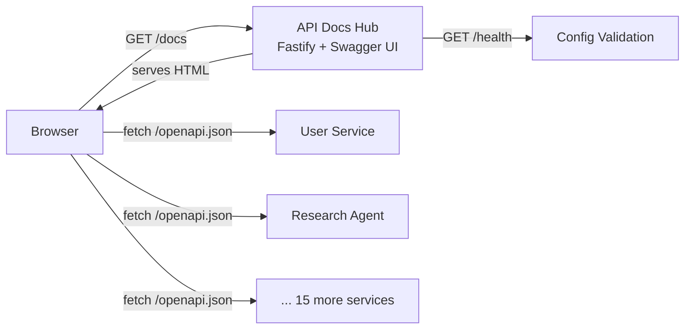
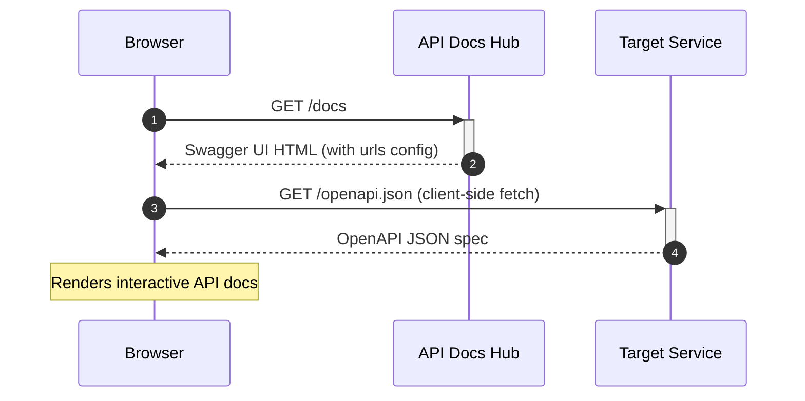

# API Docs Hub — Technical Reference

## Overview

API Docs Hub is a lightweight Fastify server that aggregates OpenAPI specifications from the selected IntexuraOS service catalog (17 sources by default) into a single Swagger UI instance. It fetches specs client-side from each service's `/openapi.json` endpoint. The service has no database, no domain logic, and no Pub/Sub integration — it exists solely to serve a configured Swagger UI.

**OpenAPI spec version:** `0.0.5`. Package version follows `apps/api-docs-hub/package.json`.

## Architecture



Note: The hub serves the Swagger UI HTML/JS. The browser then fetches individual OpenAPI specs directly from each service. The hub itself does not proxy spec requests.

## Data Flow



## Recent Changes

### Current code: profile-aware startup

`loadConfig()` validates the selected catalog at runtime. When `INTEXURAOS_API_DOCS_EXPECTED_SERVICES` is unset, all 17 catalog entries remain required. A comma-separated list of known service IDs selects a subset; empty entries, duplicates, and unknown IDs fail startup. Each selected service still needs its `*_OPENAPI_URL`. The Home PROD basic profile supplies its active service list, excluding research and message digest; the full profile uses the complete catalog. The static `REQUIRED_ENV` list remains the full catalog for repository validation.

### Changes since v3.8.0

Message Digest Service is a source in the default full `OPEN_API_SOURCE_CATALOG`. Configure `INTEXURAOS_MESSAGE_DIGEST_SERVICE_OPENAPI_URL` to expose the digest API in the same Swagger UI dropdown as the existing services. The current catalog contains 17 sources (`config.test.ts` verifies the new required entry).

| Commit      | Description                                                                        | Date       |
| ----------- | ---------------------------------------------------------------------------------- | ---------- |
| `4c899442`  | Reverted to local `OPEN_API_SOURCE_CATALOG` in config.ts; added `config.test.ts`   | 2026-03-26 |
| `7dc46e30`  | Restored shared `buildInternalApiOpenApiSources` from common-core (intermediate)   | 2026-03-25 |
| `fff14842`  | Address Opus code review findings for shared catalog                               | 2026-03-20 |
| `4c9e4003`  | Expand API catalog coverage                                                       | 2026-03-18 |

**v3.5.0 summary:** The shared `INTERNAL_API_SERVICE_CATALOG` import from `@intexuraos/common-core` was removed from `config.ts`. The service now maintains its own local `OPEN_API_SOURCE_CATALOG` constant with inline display names and environment variable mappings for active services. A new `config.test.ts` was added covering env var validation and URL trimming. The `buildOpenApiSources()` function is now defined locally rather than imported. Despite this, `@intexuraos/common-core` remains a package.json dependency (unused in source).

## API Endpoints

### Public Endpoints

| Method | Path      | Purpose                                         | Auth |
| ------ | --------- | ----------------------------------------------- | ---- |
| GET    | `/docs`   | Swagger UI with multi-spec dropdown             | None |
| GET    | `/health` | Health check — validates config source count    | None |

There are no internal endpoints. This service does not expose any `/internal/*` routes.

## Domain Model

This service has no domain model. It is a configuration-driven static documentation server.

### Configuration Model

```typescript
interface OpenApiSource {
  name: string;  // Display name in Swagger UI dropdown
  url: string;   // URL to service's OpenAPI JSON endpoint
}

interface Config {
  port: number;
  host: string;
  openApiSources: OpenApiSource[];  // Built from local OPEN_API_SOURCE_CATALOG
}
```

## Aggregated Services (17)

| Display Name | Environment Variable |
| --- | --- |
| User Service API | `INTEXURAOS_USER_SERVICE_OPENAPI_URL` |
| Notion Service API | `INTEXURAOS_NOTION_SERVICE_OPENAPI_URL` |
| WhatsApp Service API | `INTEXURAOS_WHATSAPP_SERVICE_OPENAPI_URL` |
| Mobile Notifications Service API | `INTEXURAOS_MOBILE_NOTIFICATIONS_SERVICE_OPENAPI_URL` |
| Message Digest Service API | `INTEXURAOS_MESSAGE_DIGEST_SERVICE_OPENAPI_URL` |
| Fishing Assistant Service API | `INTEXURAOS_FISHING_ASSISTANT_SERVICE_OPENAPI_URL` |
| Research Agent API | `INTEXURAOS_RESEARCH_AGENT_OPENAPI_URL` |
| Image Service API | `INTEXURAOS_IMAGE_SERVICE_OPENAPI_URL` |
| Application Settings API | `INTEXURAOS_APP_SETTINGS_SERVICE_OPENAPI_URL` |
| Notes Agent API | `INTEXURAOS_NOTES_AGENT_OPENAPI_URL` |
| Bookmarks Agent API | `INTEXURAOS_BOOKMARKS_AGENT_OPENAPI_URL` |
| Calendar Agent API | `INTEXURAOS_CALENDAR_AGENT_OPENAPI_URL` |
| Code Agent API | `INTEXURAOS_CODE_AGENT_OPENAPI_URL` |
| Linear Agent API | `INTEXURAOS_LINEAR_AGENT_OPENAPI_URL` |
| Web Agent API | `INTEXURAOS_WEB_AGENT_OPENAPI_URL` |
| Hellscript Agent API | `INTEXURAOS_HELLSCRIPT_AGENT_OPENAPI_URL` |
| Intex Agent API | `INTEXURAOS_INTEX_AGENT_OPENAPI_URL` |

## Pub/Sub

None. This service does not publish or subscribe to any Pub/Sub topics.

## Dependencies

### Packages

| Package                      | Purpose                                             |
| ---------------------------- | --------------------------------------------------- |
| `@fastify/swagger`           | OpenAPI 3.1.1 spec generation                       |
| `@fastify/swagger-ui`        | Swagger UI with multi-spec `urls` support           |
| `@intexuraos/common-http`    | `intexuraFastifyPlugin`, quiet health check logging |
| `@intexuraos/http-server`    | `registerHealthCheck`, `HealthCheck` types          |
| `@intexuraos/infra-sentry`   | Sentry error capture, `createLogStream()`           |

Note: `@intexuraos/common-core` is listed in `package.json` but is no longer imported in source code.

### External Services

None. The hub has no direct external service dependencies.

### Internal Services

None. The hub does not call any internal service APIs. It only provides URLs for the browser to fetch specs from.

## Logging Pipeline

`createLogStream()` from `@intexuraos/infra-sentry` assembles a multi-destination pino stream:

| Environment  | Output                                                      |
| ------------ | ----------------------------------------------------------- |
| `test`       | Logger disabled                                             |
| `dev` (PM2)  | Human-readable formatted output                             |
| `production` | Raw JSON + Sentry error forwarding                          |

Health check routes are excluded from request logging via `registerQuietHealthCheckLogging`.

## Configuration

### OpenAPI URL Environment Variables (17 in the default catalog)

All entries are required when `INTEXURAOS_API_DOCS_EXPECTED_SERVICES` is unset; a selected catalog requires only its own entries.

| Variable                                              | Description                        |
| ----------------------------------------------------- | ---------------------------------- |
| `INTEXURAOS_USER_SERVICE_OPENAPI_URL`                 | User Service OpenAPI JSON URL      |
| `INTEXURAOS_NOTION_SERVICE_OPENAPI_URL`               | Notion Service OpenAPI URL         |
| `INTEXURAOS_WHATSAPP_SERVICE_OPENAPI_URL`             | WhatsApp Service OpenAPI URL       |
| `INTEXURAOS_MOBILE_NOTIFICATIONS_SERVICE_OPENAPI_URL` | Mobile Notifications URL           |
| `INTEXURAOS_MESSAGE_DIGEST_SERVICE_OPENAPI_URL` | Message Digest Service OpenAPI URL |
| `INTEXURAOS_FISHING_ASSISTANT_SERVICE_OPENAPI_URL` | Fishing Assistant Service OpenAPI URL |
| `INTEXURAOS_RESEARCH_AGENT_OPENAPI_URL`               | Research Agent OpenAPI URL         |
| `INTEXURAOS_INTEX_AGENT_OPENAPI_URL`                  | Intex Agent OpenAPI URL            |
| `INTEXURAOS_IMAGE_SERVICE_OPENAPI_URL`                | Image Service OpenAPI URL          |
| `INTEXURAOS_NOTES_AGENT_OPENAPI_URL`                  | Notes Agent OpenAPI URL            |
| `INTEXURAOS_APP_SETTINGS_SERVICE_OPENAPI_URL`         | Application Settings URL           |
| `INTEXURAOS_BOOKMARKS_AGENT_OPENAPI_URL`              | Bookmarks Agent OpenAPI URL        |
| `INTEXURAOS_CALENDAR_AGENT_OPENAPI_URL`               | Calendar Agent OpenAPI URL         |
| `INTEXURAOS_CODE_AGENT_OPENAPI_URL`                   | Code Agent OpenAPI URL             |
| `INTEXURAOS_LINEAR_AGENT_OPENAPI_URL`                 | Linear Agent OpenAPI URL           |
| `INTEXURAOS_WEB_AGENT_OPENAPI_URL`                    | Web Agent OpenAPI URL              |
| `INTEXURAOS_HELLSCRIPT_AGENT_OPENAPI_URL`             | Hellscript Agent OpenAPI URL       |

### Optional Environment Variables

| Variable                         | Default       | Description                          |
| -------------------------------- | ------------- | ------------------------------------ |
| `INTEXURAOS_API_DOCS_EXPECTED_SERVICES` | Full catalog | Comma-separated known service IDs to include |
| `INTEXURAOS_SENTRY_DSN`          | -             | Sentry DSN for error tracking        |
| `INTEXURAOS_ENVIRONMENT`         | `development` | Environment name for Sentry          |
| `PORT`                           | `8080`        | Server listen port                   |
| `HOST`                           | `0.0.0.0`     | Server listen host                   |
| `LOG_LEVEL`                      | `info`        | Pino log level                       |

## Gotchas

- **Client-side spec fetching** — Swagger UI fetches specs in the browser, not on the server. Services must be accessible from the browser's network and must allow CORS from the hub's origin.
- **Config validation scope** — The health check only validates that env vars were present at startup. It does not verify that the service URLs are reachable or returning valid OpenAPI specs.
- **Empty sources = "down"** — If `openApiSources` array is empty the health check returns status `"down"`.
- **Static config** — OpenAPI source URLs are loaded once at startup. Adding or removing a service requires redeployment.
- **Shared health contract** — `registerHealthCheck()` reports `status: "ok"` when the configured source list is non-empty; successful probe details are `null`. The response does not expose a source count or probe upstream URLs.
- **Local startup** — `ecosystem.config.cjs` includes api-docs-hub on port 8133. Manual `pnpm --filter api-docs-hub start:local` uses port 8080 unless `PORT` is set.
- **Unused common-core dependency** — `@intexuraos/common-core` remains in `package.json` but is no longer imported. It can be removed to clean up the dependency graph.

## Home PROD Configuration

`ecosystem.config.prod.cjs` configures the hub with loopback binding and profile-specific OpenAPI URLs. The basic profile passes `INTEXURAOS_API_DOCS_EXPECTED_SERVICES` for its active catalog; full leaves the selector unset. These are repository deployment contracts, not a statement about the active runtime.

## File Structure

```
apps/api-docs-hub/src/
  config.ts         # OPEN_API_SOURCE_CATALOG, env var validation, buildOpenApiSources()
  server.ts         # Fastify server, Swagger UI registration, health endpoint
  index.ts          # Entry point: Sentry init, loadConfig(), listen
  __tests__/
    server.test.ts  # Health check and Swagger UI integration tests
    config.test.ts  # Selected catalog, environment validation, URL trimming
    startup.test.ts # Basic/full entrypoint startup boundaries
```

The service has no domain logic. Configuration, server behavior, and entrypoint startup have dedicated test suites.
