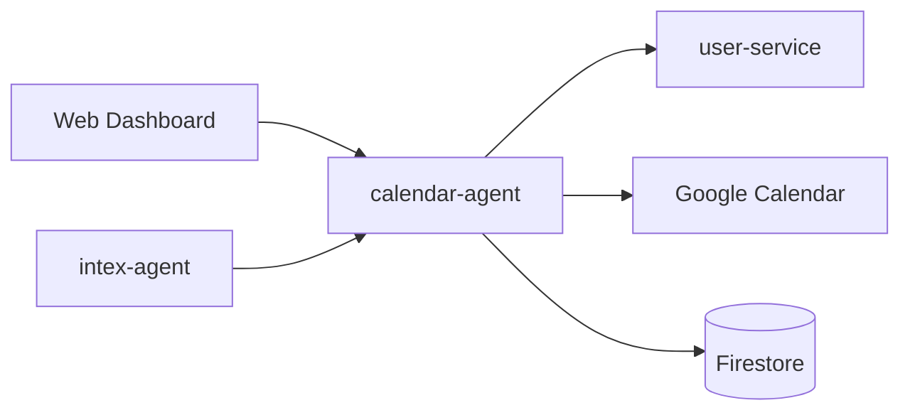

# Calendar Agent Technical Reference

Calendar Agent provides Google Calendar operations using the Google APIs client, user-service OAuth token retrieval, LLM-powered event extraction, and Firestore-backed failed-event recovery.

## Architecture

## Public Routes

| Method | Path | Purpose |
| --- | --- | --- |
| `GET` | `/connection` | Check Google Calendar connection |
| `GET` | `/events` | List calendar events |
| `POST` | `/events` | Create an event |
| `GET` | `/failed-events` | List failed extractions |
| `POST` | `/failed-events/:id/retry` | Retry a failed event |

## Internal Routes

| Method | Path | Purpose | Caller |
| --- | --- | --- | --- |
| `POST` | `/internal/calendar/events` | Create an event from a trusted service | Intex/internal clients |
| `POST` | `/internal/calendar/preview` | Generate a synchronous event preview | Internal clients |
| `GET` | `/internal/calendar/preview/:actionId` | Fetch a stored preview | Internal clients |

## Calendar Queries And Confirmed Updates

- `POST /internal/calendar/events/query` supports bounded list/count requests.
- `PATCH /internal/calendar/events/:eventId` updates identified events, including attendee additions/removals and supported event fields.
- Intex owns clarification and user confirmation. The update contract checks the confirmed event’s ETag and rejects stale snapshots with `CONFLICT`; unspecified fields are preserved.
- Multi-event Intex updates call the singular endpoint per event; they do not provide atomic rollback.

## Daily Lookahead

- `GET /schedules/calendar-daily-lookahead` reads the authenticated user’s schedule and delivery status.
- `PUT /schedules/calendar-daily-lookahead` accepts `enabled`, `localTime`, and `timeZone`; `localTime` must fall on a 15-minute boundary.
- `POST /internal/calendar/schedules/tick` claims due schedules with leases and sends the fixed next-24-hours calendar request through WhatsApp’s Matrix outbound path with `startNewSession: true`.
- Scheduling follows the configured IANA zone, including DST. A per-schedule/local-date idempotency key prevents duplicate outbound requests; transport failures retry after 15 minutes, while setup-required outcomes are recorded without that transient retry.

The lookahead window starts at actual processing time, rather than replaying the original scheduled window. The settings response separates `delivery` (Matrix readiness) from `latestRun` and `operationalState` (`never`, `pending`, `delivered`, or `failed` for an existing schedule). `latestRun.status: sent` records Matrix acceptance, not final WhatsApp delivery. Its independent `deliveryStatus`, `stage`, and optional `deliveredAt` track the correlated reply.

Stages are `trigger_pending`, `awaiting_ingress`, `processing`, `awaiting_delivery`, `delivered`, and `failed`. Each tick observes existing run receipts before claiming new work. Final delivery requires every final reply part to be confirmed delivered or read; acknowledgments do not satisfy it. A still-pending run expires after six hours with `DELIVERY_EXPIRED`.

### Operational Monitoring

Internal-authenticated `GET /internal/monitoring/status` returns the `calendar_schedule_tick` heartbeat, notification summary, and Firestore monitoring diagnostics. Heartbeats persist across restarts. Process-lifetime snapshot caches watch active schedules and a seven-day run window, avoiding a fresh history query on each status request. `resumeCutoff` keeps earlier runs as history rather than current monitoring work.

Every internal route must call `logIncomingRequest()` before auth validation.

